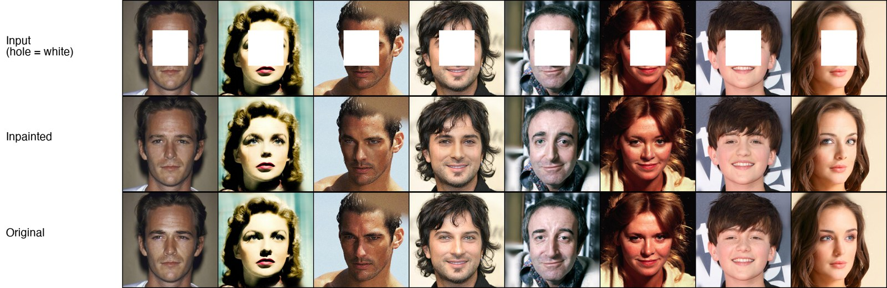

# Face inpainting: fine-tuned CelebA-HQ DDPM

A mask-aware fine-tune of [`google/ddpm-ema-celebahq-256`](https://huggingface.co/google/ddpm-ema-celebahq-256). Given a 256×256 face photo with a hole, it fills the hole with content that fits the rest of the face.

Code, training recipe and full evaluation: **https://github.com/roshan-008/face-inpainting-ddpm**


*Rows: input (hole in white) · inpainted · original. Held-out CelebA-HQ validation faces.*

## Files

| File | Content |
|---|---|
| `model.safetensors` | trained UNet weights, fp16 (6,000 fine-tuning steps; no EMA copy, no optimiser state) |
| `unet_config.json` | `UNet2DModel` config with `in_channels=7` |

## Use

```bash
git clone https://github.com/roshan-008/face-inpainting-ddpm.git && cd face-inpainting-ddpm
pip install -e .
python scripts/make_mask.py --image face.jpg --out mask.png --kind box --size 0.35
python scripts/inpaint.py --image face.jpg --mask mask.png --out result.png
```

The weights download automatically from this repo. The noise-schedule config is read from the base model. A CUDA GPU is strongly recommended: sampling runs all 1,000 denoising steps.

Input to the UNet is `[x_t (3) | photo·mask (3) | mask (1)]` with mask 1 = known pixel, 0 = hole. Sample with per-step known-pixel replacement, as implemented in `face_inpainting.sampling.inpaint`.

## Results

Hole-only metrics on the first 8 CelebA-HQ validation faces (never used for fine-tuning), seed 0:

| Mask | Hole PSNR | Hole L1 |
|---|---:|---:|
| Centre box, 96×96 (14 %) | 19.10 dB | 0.074 |
| Irregular, 2–5 rectangles (17 %) | 18.06 dB | 0.082 |
| Left half missing (50 %) | 11.60 dB | 0.219 |

## Intended use and limitations

- Research and education on diffusion-based inpainting.
- **Faces only**, aligned and front-facing like CelebA-HQ. Small or off-centre faces in wide photos give smeared results.
- Trained on rectangular holes only. Large holes produce a plausible face, not necessarily the original person.
- The base model was trained on all of CelebA-HQ, which includes the validation faces used above, so the scores may be somewhat optimistic.

## Training data and licence

- **Weights:** Apache-2.0, inherited from the base model. This is a modified version of `google/ddpm-ema-celebahq-256`; the modifications are the widened input layer and 6,000 mask-conditioned fine-tuning steps.
- **Data:** fine-tuned on 28,000 CelebA-HQ training images ([`korexyz/celeba-hq-256x256`](https://huggingface.co/datasets/korexyz/celeba-hq-256x256)). CelebA is released for **non-commercial research purposes**; please respect that when using these weights.
- Do not use this model to deceive people or to alter photos of real people without their consent.

## Citation

```
Roshan Kumar Singh. Face Inpainting with a Fine-Tuned DDPM. 2026.
https://github.com/roshan-008/face-inpainting-ddpm
```
