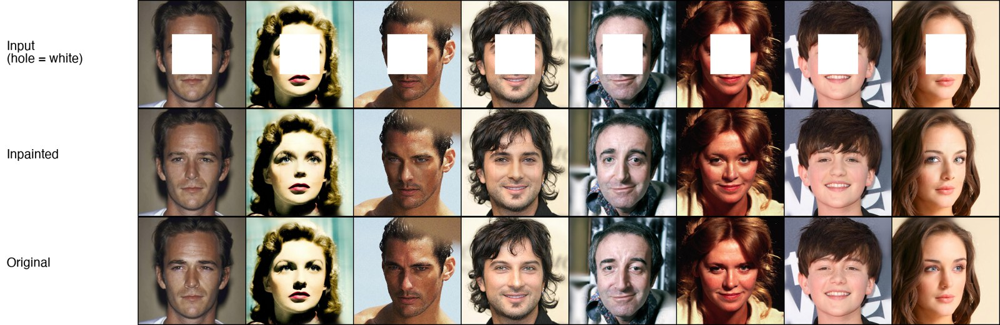
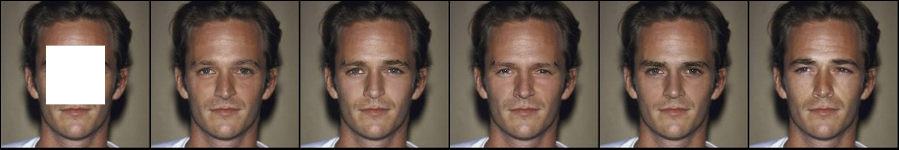
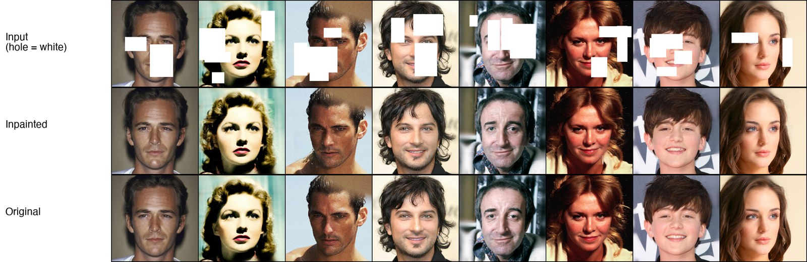
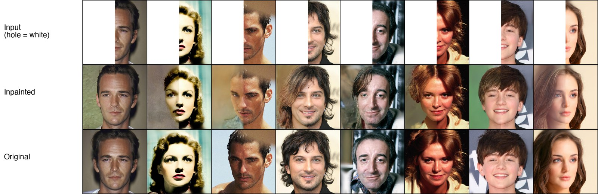
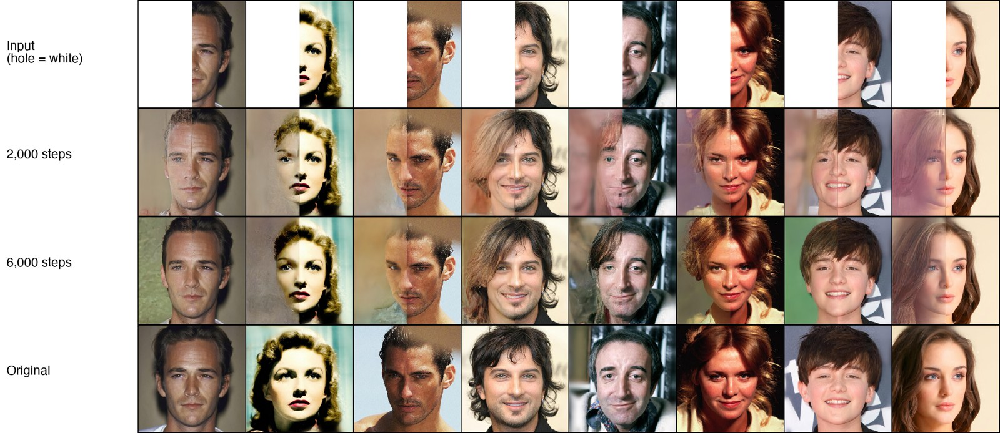

# Face Inpainting with a Fine-Tuned DDPM

[](https://github.com/roshan-008/face-inpainting-ddpm/actions/workflows/tests.yml)
[](LICENSE)


Fill missing regions of a face photo with a denoising diffusion model.

This project takes Google's pretrained CelebA-HQ diffusion model, [`google/ddpm-ema-celebahq-256`](https://huggingface.co/google/ddpm-ema-celebahq-256), and fine-tunes it into an **inpainting model**:
- **Input:** the model sees the photo with its hole, plus a mask marking the hole.
- **Output:** it generates the missing pixels so they fit the rest of the face.

Training and evaluation run on [Modal](https://modal.com) GPUs. **The trained weights are published on Hugging Face: [roshan-08/face-inpainting-ddpm](https://huggingface.co/roshan-08/face-inpainting-ddpm)**, so you can inpaint your own photos without training anything.


*Rows: input with the hole in white · inpainted · original. 8 CelebA-HQ validation faces the model never trained on, 96×96 centre hole.*

### Try it in three commands

```bash
git clone https://github.com/roshan-008/face-inpainting-ddpm.git && cd face-inpainting-ddpm
pip install -e .
python scripts/make_mask.py --image face.jpg --out mask.png --kind box --size 0.35
python scripts/inpaint.py --image face.jpg --mask mask.png --out result.png
```

The weights (228 MB) download automatically. Sampling runs all 1,000 denoising steps: about a minute on a CUDA GPU, tens of minutes on CPU.


*Left to right: input with the hole in white · four independent fills (different seeds) · original. Output of `scripts/inpaint.py` with the published weights.*

---

## Contents

1. [Results](#1-results)
2. [How it works](#2-how-it-works)
3. [Training details](#3-training-details)
4. [Getting started](#4-getting-started)
5. [Inpaint your own photo](#5-inpaint-your-own-photo)
6. [Evaluation protocol](#6-evaluation-protocol)
7. [Tests](#7-tests)
8. [Project structure](#8-project-structure)
9. [Limitations](#9-limitations)
10. [Compute and cost](#10-compute-and-cost)
11. [Acknowledgements and references](#11-acknowledgements-and-references)
12. [License and citation](#12-license-and-citation)

---

## 1. Results

**Test set:** the first 8 faces of the CelebA-HQ validation split, which were never used for training. Each face is tested with three masks. Seed 0.

**Metrics** are computed **only over the filled pixels**. Known pixels are copied into the output exactly, so including them would inflate every score.
- **Hole PSNR** (dB): how close the fill is to the original. Higher is better.
- **Hole L1:** mean absolute error in [0, 1] units. Lower is better.

Inpainting produces *a* plausible fill, not *the* original pixels, so these numbers measure closeness to the ground truth, not realism. Look at the images too.

| Mask | Hole size | Hole PSNR | Hole L1 |
|---|---:|---:|---:|
| Centre box, 96×96 | 14.1 % | **19.10 dB** | 0.074 |
| Irregular, 2–5 rectangles | 16.9 % | **18.06 dB** | 0.082 |
| Left half missing | 50.0 % | **11.60 dB** | 0.219 |

**What the images show:**
- **Small and medium holes** (box, irregular): fills have natural colour and texture. On most faces the hole can't be seen.
- **Half-face holes:** the model builds a whole, believable face that follows the visible half (eye line, face shape, hair parting). The result is a plausible face, not necessarily the same person. Some fills have an olive or green background or a faint seam down the middle.

**Irregular holes**



**Left half missing**



### Training progress

| Fine-tuning steps | Centre box | Irregular | Left half |
|---:|---:|---:|---:|
| 2,000 | 18.84 dB | 17.53 dB | 10.53 dB |
| **6,000** (final) | **19.10 dB** | **18.06 dB** | **11.60 dB** |

The largest gain from longer training is on the half-face mask. At 2,000 steps those fills were washed out, often pink, with a clear seam. At 6,000 steps they are coherent faces with natural colour.


*Rows: input · after 2,000 steps · after 6,000 steps · original.*

The full-resolution grids and `metrics.json` for both checkpoints are in [`results/`](results/).

---

## 2. How it works

### Starting point: a pretrained face model

`google/ddpm-ema-celebahq-256` is the CelebA-HQ model from Ho et al., *Denoising Diffusion Probabilistic Models* (2020), in 🤗 Diffusers format:
- a 113.7M-parameter `UNet2DModel` that predicts the noise ε in a 256×256 image;
- a 1,000-step linear β noise schedule.

It generates faces from pure noise but knows nothing about masks.

### Making it mask-aware

The UNet's first convolution takes 3 channels (the noisy image). It is widened to **7 channels**, so the model also sees the masked photo and the mask:

```
input = [ x_t (3) | photo · mask (3) | mask (1) ]      mask: 1 = known, 0 = hole
```

**Initialisation:**
- The pretrained filters for the first 3 channels are kept unchanged.
- The 4 new channels start at **zero**, so before fine-tuning the widened model behaves exactly like the pretrained one.
- Every other weight is loaded strictly from the pretrained model.

See [`src/face_inpainting/model.py`](src/face_inpainting/model.py).

### Training

The objective is standard DDPM ε-prediction on CelebA-HQ, with a random hole mask for every image:
1. Take a clean face and a random mask. 45 % of masks are one rectangle; the rest are 2–5 overlapping rectangles, each 24–110 px per side.
2. Add noise at a random level *t*.
3. Train the model to predict that noise from `[noisy face, face · mask, mask]`.

Because the clean pixels around the hole are in the input, the model learns to generate content that fits them.

### Inpainting (sampling)

Start from pure noise and run all 1,000 noise levels once ([`src/face_inpainting/sampling.py`](src/face_inpainting/sampling.py)):

```
x = random noise
for t = 999 … 0:
    ε = model([x, photo · mask, mask], t)          # predict the noise
    x = one DDPM step from x using ε                # remove a little noise
    x = mask · noised(photo, t−1) + (1−mask) · x    # put the known pixels back
```

After every step the known region is overwritten with the real photo, noised to the level of the next step. The fill therefore has to agree with its border at every noise level, not only at the end. This known-pixel replacement goes back to Song et al. (2021). The last step uses the clean photo, so known pixels in the output are exact.

---

## 3. Training details

| Parameter | Value |
|---|---|
| Base weights | `google/ddpm-ema-celebahq-256`, 113.7M params, input widened 3 → 7 channels |
| Data | CelebA-HQ 256×256 ([`korexyz/celeba-hq-256x256`](https://huggingface.co/datasets/korexyz/celeba-hq-256x256)): 28,000 training images; the 2,000 validation images are held out |
| Optimiser | AdamW, learning rate **1e-5**, weight decay 1e-2, constant schedule |
| Batch | **4** images × **8** gradient-accumulation steps = **32** images per optimiser step |
| Steps | **6,000** (192,000 images ≈ 6.9 epochs) |
| Precision | fp16 autocast with `GradScaler`, gradient clipping at 1.0 |
| Noise schedule | the pretrained `DDPMScheduler`: 1,000 steps, linear β |
| EMA | decay 0.9999, saved alongside the trained weights |
| Checkpoints | every 500 steps, written atomically to the Modal Volume |
| Seed | 0; a resumed run re-seeds with `seed + start_step` so it doesn't replay earlier batches |
| Hardware | 1 × NVIDIA L4, ≈ 3.7 s per step, ≈ 6 h in total |

**Training loss** (ε-MSE, mean of 10 logged values):

| Steps | 1–250 | 1,775–2,000 | 5,775–6,000 |
|---|---:|---:|---:|
| Loss | 0.0120 | 0.0051 | 0.0042 |

**Results use the trained weights, not the EMA copy.** With decay 0.9999, after 6,000 steps the EMA still holds 0.9999⁶⁰⁰⁰ ≈ 55 % of the *initial* weights, whose mask channels are all zero. The EMA model therefore uses the mask far less. The EMA weights are still saved (`weights="ema"` in `load_checkpoint`).

**How the published checkpoint was trained:** in segments. Steps 1–2,000 ran first; training then resumed to 6,000, and was interrupted once at step 2,349. Each resume re-seeds, so a single uninterrupted run follows the same recipe but draws different random batches.

---

## 4. Getting started

### Requirements

- Python 3.10+
- To only inpaint photos: nothing else (a CUDA GPU is recommended). To train or re-evaluate: a [Modal](https://modal.com) account; those steps run on Modal.

```bash
git clone https://github.com/roshan-008/face-inpainting-ddpm.git && cd face-inpainting-ddpm
pip install -e ".[modal,dev]"     # the package, Modal client and pytest
modal setup                       # one-time browser login
```

### Train and evaluate

Every command runs from the repository root. All data, weights, checkpoints and results live in a Modal Volume, `image-inpainting-training` by default (set `IMAGE_INPAINTING_VOLUME` to change it).

```bash
# 1. Copy the pretrained model into the Volume (CPU, ~1 min)
modal run modal_app.py::clone_pretrained

# 2. Download CelebA-HQ and write 28k training / 2k validation faces (CPU, ~10 min)
modal run modal_app.py::prepare_data

# 3. Fine-tune for 6,000 steps on an L4 (~6 h). Resumes from the last checkpoint if restarted.
modal run --detach modal_app.py::train --spawn

# 4. Score the held-out faces (L40S, ~10 min) and download the grids + metrics
modal run modal_app.py::evaluate
modal volume get image-inpainting-training /results/eval/ ./results/
```

**About `--spawn`:** it starts training on Modal and returns immediately, so the run doesn't depend on your machine staying connected. Follow it with `modal app logs <app id>`; the id is the `ap-…` part of the run URL printed at launch. Training resumes from `runs/<run_name>/latest.pt` whenever that file exists.

**Options:**
- `train`:
  - `--total-steps` (default 6,000, up to 20,000)
  - `--learning-rate`, `--batch-size`, `--gradient-accumulation`, `--checkpoint-every`, `--seed`
  - `--run-name` (separate runs live in separate folders)
- `evaluate`:
  - `--checkpoint step_002000.pt` scores an earlier checkpoint (default `latest.pt`)
  - `--n-faces`, `--seed`, `--weights model|ema`, `--run-name`
- GPU types: set `TRAIN_GPU` (default `L4`) or `EVAL_GPU` (default `L40S`).

---

## 5. Inpaint your own photo

**1. Make a mask** the same size as the photo: white = keep, black = fill. Paint one in any editor, or generate one:

```bash
python scripts/make_mask.py --image face.jpg --out mask.png --kind box --size 0.35
python scripts/make_mask.py --image face.jpg --out mask.png --kind random --hole-fraction 0.25 --seed 7
```

**2. Upload both and inpaint:**

```bash
modal volume put image-inpainting-training face.jpg /input/face.jpg
modal volume put image-inpainting-training mask.png /input/mask.png

modal run modal_app.py::inpaint_image --image /input/face.jpg --mask /input/mask.png --samples 4

modal volume get image-inpainting-training /results/inpaint_face.png .
```

The output is one strip: masked input | 4 independent fills | original.

**Notes:**
- Inputs are centre-cropped to a square and resized to 256×256.
- Use `--invert-mask` if your mask is white where it should fill.
- For best results, use a **front-facing face that fills most of the frame**, like a CelebA-HQ portrait (see [Limitations](#9-limitations)).

**Use it from Python** (any CUDA machine with the package installed):

```python
import torch
from diffusers import DDPMScheduler
from face_inpainting.data import load_photo_and_mask
from face_inpainting.model import load_pretrained   # or load_checkpoint(path) for a training checkpoint
from face_inpainting.sampling import inpaint

unet = load_pretrained("roshan-08/face-inpainting-ddpm", device="cuda")   # downloads from the Hub
scheduler = DDPMScheduler.from_pretrained("google/ddpm-ema-celebahq-256")
photo, mask = load_photo_and_mask("face.jpg", "mask.png")
result = inpaint(unet, scheduler, photo.cuda(), mask.cuda(), torch.Generator("cuda").manual_seed(0))
```

The training checkpoint (1.8 GB, with optimiser state) is not in this repository; `train` writes it to the Modal Volume. The released weights are a 228 MB fp16 export of the trained model: see [`scripts/export_weights.py`](scripts/export_weights.py) to make one from your own run.

---

## 6. Evaluation protocol

**Faces:** the first 8 images, in sorted order, of the CelebA-HQ validation split. None were used for fine-tuning.

**Masks** (256×256), generated deterministically by `eval_mask` in [`src/face_inpainting/masks.py`](src/face_inpainting/masks.py):
- `box`: centred 96×96 hole (14.1 %).
- `irregular`: 2–5 overlapping rectangles, 24–110 px per side, seeded per face (`1000 + index`). Mean hole 16.9 %.
- `half`: left half missing (50 %).

**Sampling:** 1,000-step DDPM sampling with per-step known-pixel replacement, fp16, on an L40S, seed 0. Each mask set uses a fresh generator seeded with 0.

**Metrics** ([`src/face_inpainting/metrics.py`](src/face_inpainting/metrics.py)): hole PSNR and hole L1 per image, averaged over the 8 faces.

Re-running `evaluate` on the same checkpoint reproduces these numbers to within GPU floating-point noise (about 0.0001 dB).

---

## 7. Tests

```bash
pytest
```

19 CPU tests run in a few seconds, using a tiny UNet in place of the real model. They check:
- **Masks:** the evaluation masks have the right shapes and sizes, and the training masks are reproducible for a given seed.
- **Model:** the widened 7-channel model gives exactly the pretrained model's output before training, and checkpoints and the released-weights format load back unchanged.
- **Sampling:** known pixels come out exact, and sampling is deterministic for a given seed.
- **Metrics:** hole PSNR and L1 ignore known pixels.
- **Data:** photos and masks are cropped, resized, scaled and validated correctly.

---

## 8. Project structure

```
face-inpainting-ddpm/
├── modal_app.py                 Modal entry points: clone_pretrained · prepare_data · train · evaluate · inpaint_image
├── src/face_inpainting/
│   ├── model.py                 widen the pretrained UNet to 7 input channels; load checkpoints
│   ├── sampling.py              inpainting sampler (DDPM + per-step known-pixel replacement)
│   ├── masks.py                 random training masks and deterministic evaluation masks
│   ├── data.py                  CelebA-HQ folder dataset; photo + mask loading
│   └── metrics.py               hole PSNR and hole L1
├── scripts/make_mask.py         make a mask for your own photo (Pillow only)
├── scripts/inpaint.py           inpaint a photo locally with the released weights
├── scripts/export_weights.py    turn a training checkpoint into the release weights
├── MODEL_CARD.md                model card published on Hugging Face
├── tests/                       CPU unit tests (pytest)
├── results/
│   ├── step_006000/             final model: grids + metrics.json
│   └── step_002000/             after 2,000 steps
├── assets/                      images used in this README
├── .github/workflows/tests.yml  CI: runs the unit tests on every push
├── LICENSE · CITATION.cff
└── pyproject.toml
```

Mask convention everywhere: **1 / white = known pixel, 0 / black = hole.**

---

## 9. Limitations

- **Faces only.** The model inherits the CelebA-HQ prior: aligned, front-facing, tightly cropped faces. A small or off-centre face in a wider photo gives smeared results. Crop to the face first.
- **Trained on rectangular holes only.** Free-form holes, such as a round one, work but can leave a faint thin outline along the hole's edge.
- **Large holes are plausible, not faithful.** With half the face missing, the model invents a believable face that may not match the person. Some half-face fills also show an olive or green background or a faint seam.
- **Short fine-tune.** 6,000 steps (≈ 6.9 epochs) is enough to learn the mask inputs, and scores were still rising at the end. The script allows up to 20,000 steps.
- **The starting weights saw the validation faces.** Google's model was trained on all 30,000 CelebA-HQ images, which include the 2,000-image validation split. Fine-tuning never saw them, but the pretrained weights did, so scores on these faces may be somewhat optimistic.
- **256×256 only.** This is the pretrained model's native resolution.

---

## 10. Compute and cost

At Modal list prices (L4 $0.80/h, L40S $1.95/h):

| Job | GPU | Time | ≈ Cost |
|---|---|---:|---:|
| Clone model + prepare data | CPU | ~15 min | < $0.10 |
| Fine-tune, 6,000 steps | L4 | ~6 h | ~$5 |
| Evaluate one checkpoint | L40S | ~10 min | ~$0.35 |

---

## 11. Acknowledgements and references

- **Pretrained model:** [`google/ddpm-ema-celebahq-256`](https://huggingface.co/google/ddpm-ema-celebahq-256). See its model card for terms of use.
- **Data:** CelebA-HQ (Karras et al., 2018), derived from CelebA (Liu et al., 2015), via [`korexyz/celeba-hq-256x256`](https://huggingface.co/datasets/korexyz/celeba-hq-256x256). CelebA is released for non-commercial research purposes; check the dataset terms before other uses.
- J. Ho, A. Jain, P. Abbeel. *Denoising Diffusion Probabilistic Models.* NeurIPS 2020.
- Y. Song et al. *Score-Based Generative Modeling through Stochastic Differential Equations.* ICLR 2021. Inpainting by replacing known pixels during sampling.
- T. Karras, T. Aila, S. Laine, J. Lehtinen. *Progressive Growing of GANs for Improved Quality, Stability, and Variation.* ICLR 2018. CelebA-HQ.
- Z. Liu, P. Luo, X. Wang, X. Tang. *Deep Learning Face Attributes in the Wild.* ICCV 2015. CelebA.
- 🤗 [Diffusers](https://github.com/huggingface/diffusers): `UNet2DModel`, `DDPMScheduler`.

---

## 12. License and citation

Code: [MIT](LICENSE). The published weights are Apache-2.0 (inherited from the base model) and, because they were fine-tuned on CelebA-HQ, are intended for non-commercial research use; see section 11 and the [model card](MODEL_CARD.md). To cite this repository, use [`CITATION.cff`](CITATION.cff) (GitHub's "Cite this repository" button).
